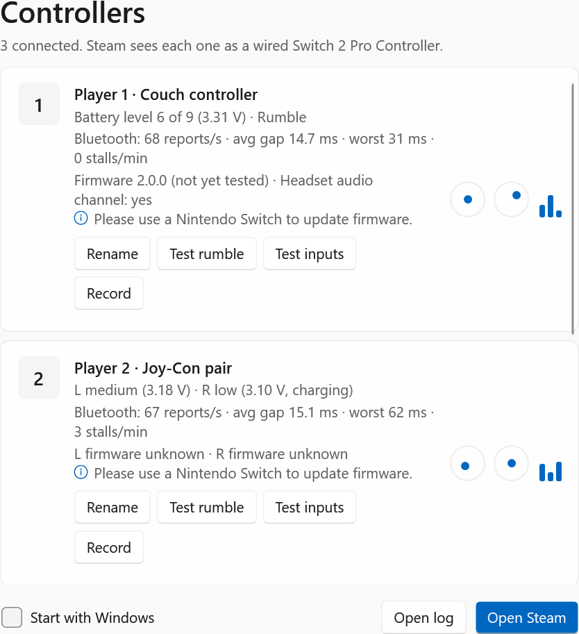
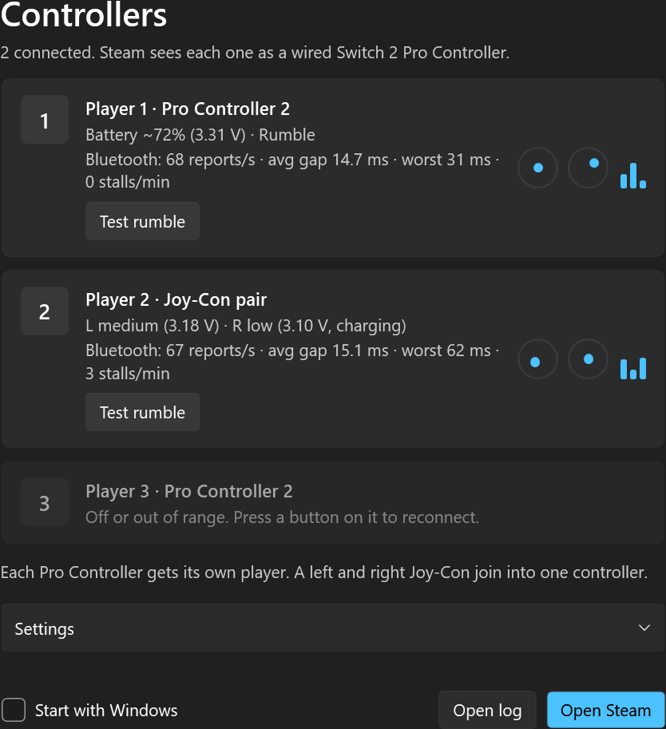

# Switch 2 Native Bridge

Use Nintendo Switch 2 Pro Controllers and Joy-Cons **over Bluetooth** on Windows, with **Steam treating them as wired Switch 2 Pro Controllers**. Steam Input handles everything: button mapping, gyro, back buttons (GL/GR), rumble, and per-game configs.

Steam only supports the Switch 2 Pro Controller over USB. On Bluetooth, the existing tools pretend to be an Xbox or PS4 controller and handle mapping and gyro themselves. This bridge doesn't do any of that. It reads the controller over Bluetooth and passes its raw data to a virtual *wired* Pro Controller 2, so Steam does the rest.

| Light | Dark |
| --- | --- |
|  |  |

## What it does

- **Native in Steam.** Steam sees a wired Switch 2 Pro Controller. The bridge doesn't remap anything or process the gyro.
- **Every input.** All buttons including GL, GR and C, both sticks, gyro and accelerometer, passed through byte-for-byte.
- **Your controller's own calibration.** The bridge reads the stick and motion calibration from the controller and gives it to Steam, the same way a USB connection would.
- **Rumble.** Steam's rumble goes back to the controller.
- **Several controllers.** Each Pro Controller is its own player.
- **Joy-Cons.** A left and a right Joy-Con are merged into one Pro Controller (left stick and buttons from the left Joy-Con, right stick, buttons and gyro from the right one). A single Joy-Con also works.
- **Survives reconnects.** If a controller drops, its virtual controller stays in place for Steam, and pressing a button reconnects it.
- **Tray app.** Runs from the system tray in a native Windows 11 status window that follows light/dark mode, and starts with Windows.

## Requirements

- Windows 10/11 x64 with a Bluetooth adapter that supports Bluetooth Low Energy
- Steam
- Admin rights (one prompt on first run; after that the bridge starts with Windows without a prompt)

## Install

1. Download `Switch2Bridge-v<version>.exe` from Releases, or build it (below). Keep it somewhere permanent, because Start with Windows runs it from that location.
2. If you've paired the controller in Windows' Bluetooth settings, **remove it there**. The bridge connects to it directly.
3. Close any other Switch 2 bridge app (e.g. switch2pc) so they don't fight over the controller.
4. Run `Switch2Bridge.exe` and approve the admin prompt. The first run:
   - installs HIDMaestro's virtual controller driver and its virtual USB driver (usbip-win2, Microsoft-signed), and adds HIDMaestro's self-signed driver certificate to the machine's trusted certificates;
   - turns on **Start with Windows**, using a Task Scheduler logon task so there's no UAC prompt each time. Switch it off in the status window or the tray menu.
5. **New controller:** hold its Sync button until the lights sweep. **Paired before:** press any button.

The status window opens from the tray icon (left-click). Right-click the icon for the menu. The log is at `%LOCALAPPDATA%\Switch2Bridge\bridge.log`.

### Uninstall

Quit the bridge from the tray, untick **Start with Windows** first if you want the startup task removed, then run `HIDMaestroUninstall.exe` from the [HIDMaestro release](https://github.com/hifihedgehog/HIDMaestro/releases). That removes its drivers, certificate and virtual devices. Delete `%LOCALAPPDATA%\Switch2Bridge` to clear the bridge's own settings and log.

## How it works

```
Controller ──BLE GATT──▶ Switch2Bridge ──HIDMaestro──▶ virtual USB Switch 2 Pro Controller ──▶ Steam
```

- **Bluetooth side** (`SwitchController.cs`): connects with WinRT's Bluetooth LE APIs, runs the controller's GATT command protocol (read flash, pair, enable motion, player LEDs, rumble) and receives its input reports.
- **USB side** (`VirtualPad.cs`): HIDMaestro's `switch2-pro-controller-composite` persona is a two-interface USB device that answers the bulk command protocol Steam uses to start a wired Pro Controller 2. A wired pad's input report 0x05 is the Bluetooth input report with a report ID added, so buttons, sticks and IMU words are copied across unchanged. The persona's flash image is replaced with the controller's own calibration.
- **Joy-Cons**: in vertical grip both Joy-Cons use the Pro Controller's stick slots and IMU axes, so merging them is a matter of picking each side's bytes.

`Switch2Bridge.exe --selftest` runs offline checks (no controller, driver or admin needed). It replays the persona's own report program over the bridge's output and checks that 21 buttons, both sticks and the IMU come out byte-for-byte, and that Joy-Con merging and flash composition are correct.

## Build

Requires the .NET 10 SDK.

```
powershell -NoProfile -File tools\build.ps1
```

This builds, runs the self-test, and writes `artifacts\release\Switch2Bridge-v<version>.exe` with a `.sha256` file next to it. All build output (bin, obj, publish, release) lives under `artifacts\`. The exe name includes the version, so a running bridge never blocks the next build.

`lib/HIDMaestro.Core.dll` is HIDMaestro v2.1.0 from its [official release](https://github.com/hifihedgehog/HIDMaestro/releases/tag/v2.1.0) (release zip SHA-256 `7fe349f163864b8dfc36117af260d51bac94a2263b6cdfa719cb364a808397b4`).

## Known limits

- Steam may label the device "Nintendo Switch Pro Controller" rather than "Switch 2".
- Battery: the bridge passes the controller's real voltage to Steam, but Steam's Switch 2 support (SDL) doesn't read battery for this controller, so Steam may show none. The status window shows high/medium/low from voltage, because Nintendo's voltage-to-percent curve isn't public.
- Joy-Con support follows the same protocol as the Pro Controller, but has had less real-world testing.
- Headset audio, NFC and the magnetometer aren't passed through (HIDMaestro's persona doesn't emulate them).

## Credits

- [HIDMaestro](https://github.com/hifihedgehog/HIDMaestro) by hifihedgehog (MIT): the virtual wired Pro Controller 2 that makes native Steam support possible.
- [Nadeflore/switch2-controllers](https://github.com/Nadeflore/switch2-controllers): Switch 2 controller Bluetooth protocol reverse engineering.
- [TommyWabg/switch2-controllers-windows10-gyro](https://github.com/TommyWabg/switch2-controllers-windows10-gyro) and [CareyScott/switch2controllerpc](https://github.com/CareyScott/switch2controllerpc) (MIT): the Windows implementations this bridge's Bluetooth code follows.

Not affiliated with Nintendo or Valve. Nintendo Switch, Joy-Con and Steam are trademarks of their owners.

## License

MIT. See [LICENSE](LICENSE). Third-party notices are in [THIRD-PARTY-NOTICES.md](THIRD-PARTY-NOTICES.md).
